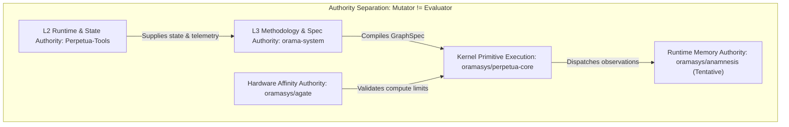
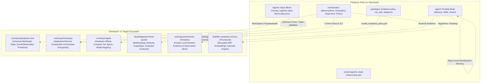
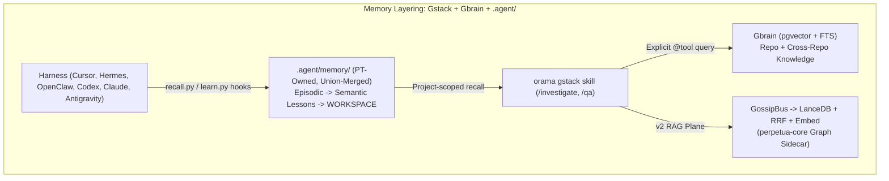
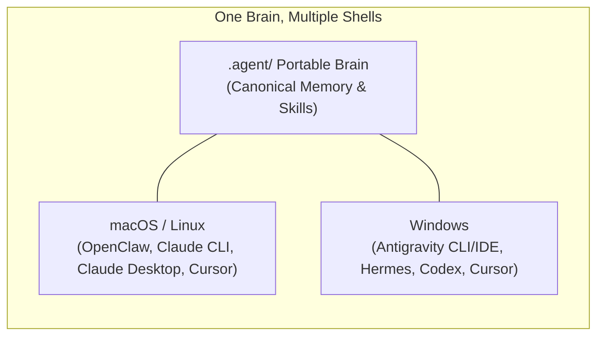
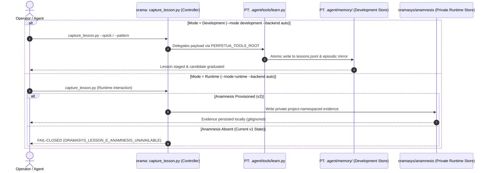
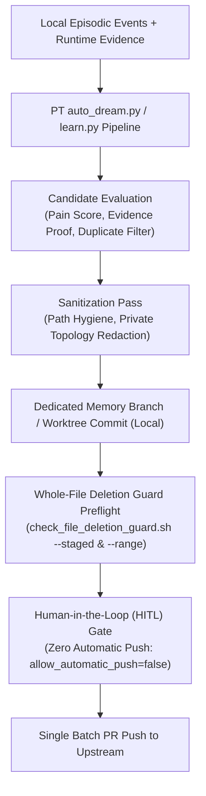
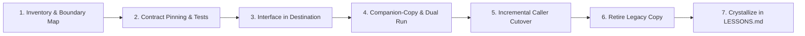

> **Alexandria ingest:** 2026-09-25 · docs-only copy · portable-memory scrubbed (no workstation paths / local topology).

# Architecture & Migration Provenance: PT `.agent` Portable Brain, Agentic-Stack Overlay, and Cross-Repo Lesson Capture to `oramasys/*` v2

**Document Type:** Strategic Migration Map, Architectural Contract, and Provenance Synthesis  
**Authoring Stack:** Antigravity / Gemini 3.8 Flash & Oramasys Methodology  
**Repositories Involved:**
- `diazMelgarejo/Perpetua-Tools` (v1 L2 Runtime & Host Monorepo)
- `diazMelgarejo/orama-system` (v1 L3 Stateless Methodology & Specification Authority)
- `oramasys/perpetua-core` (v2 Pure Microkernel Execution Graph)
- `oramasys/oramasys` (v2 Application & Service Composition)
- `oramasys/agate` (v2 Hardware Affinity & Topology Registry)
- `oramasys/anamnesis` (Tentative v2 Private Runtime Memory Backend)
- `codejunkie99/agentic-stack` (Upstream Vendor Submodule)
**Date:** 2026-09-25  
**Canonical Anchors in Source Repos:**
- `Perpetua-Tools/.agent/memory/semantic/PT_UNBUNDLING_MIGRATION_MAP_2026-08-29.md`
- `orama-system/docs/reference/2026-08-25-lessons-and-memory-capture-timeline.md`
- `orama-system/docs/v2/56-anamnesis-runtime-memory-migration.md`
- `orama-system/docs/v2/41-agentic-stack-gstack-gbrain-memory-blend.md`
- `orama-system/docs/v2/47-portable-memory-local-topology-invariant.md`
- `Perpetua-Tools/.agent/memory/working/2026-07-16-agentic-stack-upstream-contribution-plan.md`
- `Perpetua-Tools/.agent/memory/working/2026-08-07-vendor-blend-and-upstream-contribution-retrospective.md`

---

## 1. Executive Summary & Problem Framing

Throughout the evolution of the **Perpetua-Tools (PT)** and **orama-system** codebases (v1), Perpetua-Tools acted as an integration monorepo hosting both runtime infrastructure and a portable cognitive brain. Within PT, the `.agent/` directory served as the central nerve center—housing episodic memory, semantic lessons, harness-neutral hooks, candidate graduation workflows, and vendor adaptations.

However, the architecture faced two structural tensions:
1. **The Monorepo Congestion / Submodule Bleed:** PT vendored `codejunkie99/agentic-stack` under `vendor/agentic-stack` while heavily customizing its tools (`learn.py`, `recall.py`, hooks) via an in-tree overlay. Direct upgrades risked clobbering in-house adaptations.
2. **The Asymmetric Lesson Capture Authority:** `orama-system` originally maintained a naive direct-append script (`capture_lesson.py` writing to `tasks/lessons.md`), creating split-brain divergence against PT's canonical `lessons.jsonl`. Furthermore, an incident on 2026-08-24 (where an unintended tree-API publication dropped 1,881 files / 270k lines) highlighted the critical need for strict whole-file deletion guards and explicit memory authority boundaries.

This document synthesizes the historical and locked architectural design for:
- How the **`.agent/` directory, Agentic-Stack overlay, and PT harness** unbundle into the **`oramasys/*` v2** ecosystem.
- How **lesson capture, candidate graduation, and weekly crystallization** operate across the v1 to v2 boundary without data loss or cognitive drift.

---

## 2. Master Authority Matrix: v1 Authority vs. v2 Direction

| Concern | v1 Authority | v2 Direction | Non-Negotiable Boundary |
| :--- | :--- | :--- | :--- |
| **Development / System Lessons** | PT tracked `.agent/` Agentic-Stack | Continues as repository-development memory | Orama must not silently create a competing canonical log. |
| **Capture Frontend** | `bin/orama-system/scripts/capture_lesson.py` | Same user-facing workflow / controller | Backends are explicit and fail closed when unavailable. |
| **User / Runtime Evidence** | Not implemented in v1 | Tentative `oramasys/anamnesis` | Private by default; never substituted by a tracked fallback. |
| **Cross-Project Memory** | PT bundle, internally scoped by context | User-level runtime bundle with project namespaces/tags | Project-specific evidence is not automatically general policy. |
| **Candidate Promotion** | PT `learn.py`, `auto_dream.py`, human review | Weekly crystallization joins dev lessons & runtime evidence | Sanitize before commit and again immediately before push. |
| **Publication & Sync** | Git / PR workflow | Same | `allow_automatic_push=false` by default; strict HITL gating. |

---

## 3. The Unbundling Architecture: Migrating from PT v1 to `oramasys/*` v2

Per the foundational doctrine in `Perpetua-Tools/.agent/memory/semantic/PT_UNBUNDLING_MIGRATION_MAP_2026-08-29.md`:

> **Core Axiom:** *Unbundle by stable capability contract and authority boundary, not by file location and not by copying everything into `perpetua-core`.*

### Destination Capability Breakdown

| Target Repository / Module | Allocated Responsibilities | What Must NOT Enter |
| :--- | :--- | :--- |
| **`oramasys/perpetua-core`** | Universal execution primitives: `PerpetuaState`, `MiniGraph`, `CompiledGraph`, `GraphEvent`, `GraphObservation`, generic tool-schema derivation, generic streaming/checkpoint interfaces. | **No** provider clients, API servers, endpoint policy, hardware affinity, long-term memory stores, or telemetry exporters. |
| **`oramasys/agate`** | Hardware capability & affinity authority: `model_hardware_policy.yml`, GGUF quantization tiers, VRAM budgets, Apple Silicon vs CUDA constraints, capability routing. | **No** provider wire formats, application billing, or graph scheduling code. |
| **`oramasys/oramasys`** | Application & service composition: FastAPI glass-window endpoints, user sessions, approved `GraphSpec` consumption, orchestration daemons, CLI tools. | Satellites and core must not depend on application code. |
| **`diazMelgarejo/orama-system`** | Stateless specification & methodology authority: `GraphSpec`, `NodeSpec`, `EdgeSpec`, compiler/linter rules, March-of-Nines doctrine, verification/evaluator contracts (`mutator != evaluator`). | Does not host live state stores; targets `perpetua-core` without core importing upward. |
| **`oramasys/anamnesis`** *(Tentative)* | Private local runtime memory: user interactions, local execution telemetry, gitignored private evidence, project-namespaced observations. | Never mixed into public git tracking by default. |
| **`perpetua-memory`** *(Satellite)* | Reusable algorithmic memory engine: Reciprocal Rank Fusion (RRF), episodic embeddings, candidate graduation state-machine. | Decoupled from repo-specific `.agent` markdown files. |

---

## 4. The Agentic-Stack Overlay & Patch Management

Per `Perpetua-Tools/.agent/memory/working/2026-07-16-agentic-stack-upstream-contribution-plan.md` and `orama-system/docs/v2/41-agentic-stack-gstack-gbrain-memory-blend.md`:

### 4.1 The Union-Blend Doctrine
PT vendors `agentic-stack` at `vendor/agentic-stack` as a clean submodule pin (e.g., `00eda65c`). The customizations are **never committed into the submodule**. Instead, PT maintains a tracked blend state:
- `.agent/.agentic-stack-blend-state.json` catalogs clean patches applied on top of the vendor skeleton (UTF-8 encoding guards, context-manager fixes, `_append_episodic_mirror()` in `learn.py`, path-hygiene sanitizers).
- **Mandatory Dry-Run Gating:** Upgrades are executed via `python3 -m harness_manager.cli upgrade --dry-run "$PT_ROOT"` to inspect file deltas before applying.
- **External Brain Blockade:** Upstream `codejunkie99/brain` integrations (`brain_bridge.py`) are deliberately blocked in favor of **Gbrain (gstack pgvector + FTS)** until a dual-backend multiplexer is formally reviewed.

### 4.2 Patch Portability & Upstream Contribution Breakdown

| Patch # | Patch Description | Portable Upstream? | Depends on PT-only code? | Action in Upstream Stack |
| :--- | :--- | :---: | :---: | :--- |
| **1** | UTF-8 stdout/stderr reconfigure at import | Yes | No | Fork PR #2 (`atomic-02-utf8-encoding-fixes`) |
| **2** | `_lesson_already_appended`: safe `with open(..., encoding="utf-8")` | Yes | No | Fork PR #2 (`atomic-02-utf8-encoding-fixes`) |
| **3** | `path_hygiene.sanitize_tracked_path_leaks` on claim + rationale | **No** | **Yes** (PT module) | **Stays PT-local overlay** |
| **4** | Candidate-file write: explicit UTF-8 context manager | Yes | No | Fork PR #3 (`atomic-03-context-manager-fix`) |
| **5** | `_append_episodic_mirror()` — ensures episodic record on manual stage | Yes | No | **Fork PR #1 (Pilot: `atomic-01-episodic-mirror-fix`)** |
| **6** | Call site wiring for #5 inside `stage()` | Yes | No | Fork PR #1 (`atomic-01-episodic-mirror-fix`) |

---

## 5. Harness Coverage Matrix across Platforms

| Host OS | Target Environment | Upstream Adapter | PT / Orama Loading Surface |
| :--- | :--- | :--- | :--- |
| **Windows** | Antigravity CLI / IDE | `antigravity` | `ANTIGRAVITY.md` $\rightarrow$ `.agent/AGENTS.md` mount |
| **Windows** | Hermes | `hermes` | Thin `/pt-orama-*` wrappers $\rightarrow$ canonical orama skills |
| **Windows** | Cursor Agent / CLI | `cursor` | `.cursor/` rules + skills mirror |
| **Windows** | Codex CLI | `codex` | `.codex/` wrappers |
| **Windows** | Claude Desktop App | `claude-code` | `.claude/settings.json` hooks $\rightarrow$ `.agent/harness/hooks/` |
| **macOS / Linux** | OpenClaw | `openclaw` | orama `openclaw-skills` + AlphaClaw lifecycle |
| **macOS / Linux** | Claude CLI (`claude`) | `claude-code` | `.claude/skills/` thin wrappers |
| **macOS / Linux** | Cursor Agent | `cursor` | `.cursor/` mirror |

---

## 6. The Final Shape of Lesson Capture & Cross-Repo Uploads

The evolution of lesson capture underwent a critical architectural correction on **2026-08-25** following the deletion-guard crisis, formalized in `orama-system/docs/v2/56-anamnesis-runtime-memory-migration.md` and `orama-system/docs/reference/2026-08-25-lessons-and-memory-capture-timeline.md`.

### 6.1 Controller Invocation Modes

| Invocation Command | Target Backend | Behavior & Fail-Closed Guards |
| :--- | :--- | :--- |
| `capture_lesson.py --mode development --backend auto` | `pt-agent` | Requires `PERPETUA_TOOLS_ROOT` (or `--pt-root`); delegates directly to `.agent/tools/learn.py`. |
| `capture_lesson.py --quick` | `pt-agent` / active | Collects one prevention rule and produces a complete structured payload. |
| `capture_lesson.py --review` / `--stats` | PT semantic view | Read-only inspection of PT's rendered semantic lessons; never mutates memory. |
| `capture_lesson.py --backend legacy` | Legacy Markdown | Explicit compatibility path for an already-initialized log; never creates a new v1 log implicitly. |
| `capture_lesson.py --mode runtime --backend auto` | `anamnesis` | **Fails closed** with `ORAMASYS_LESSON_E_ANAMNESIS_UNAVAILABLE` until v2 Anamnesis is provisioned. |

### 6.2 The Weekly Crystallization & Upload Workflow

---

## 7. Strangler Migration Roadmap: Step-by-Step Execution

1. **Inventory & Boundary Mapping:** Identify imports, consumers, and persistent storage boundaries (do not rely on directory names).
2. **Contract Pinning:** Ensure existing test suites pass 100% (e.g. PT pytest suites, OTel lifecycle tests, endpoint-policy parity checks).
3. **Interface Definition in Destination:** Define the clean abstract interface in `oramasys/perpetua-core` or satellite packages without provider dependencies.
4. **Companion-Copy / Mirror Run:** Deploy the new package behind the interface; run differential tests between legacy PT and v2 implementation.
5. **Consumer Cutover:** Redirect callers one by one to the new module.
6. **Retire Legacy Writable Copy:** Delete legacy implementation only after all callers have migrated and contract tests verify zero regression.
7. **Durable Memory Graduation:** Log the completed migration and any architectural trade-offs via `learn.py` into `.agent/memory/semantic/LESSONS.md`.

---

## 8. Comprehensive Cross-Reference Index

| Canonical Document | Repository Location | Key Architectural Contribution |
| :--- | :--- | :--- |
| **PT Unbundling Migration Map** | `Perpetua-Tools/.agent/memory/semantic/PT_UNBUNDLING_MIGRATION_MAP_2026-08-29.md` | Defines the 12-cluster unbundling boundaries from PT into core, agate, oramasys, and satellites. |
| **Lessons & Memory Capture Timeline** | `orama-system/docs/reference/2026-08-25-lessons-and-memory-capture-timeline.md` | Complete chronology of lesson capture evolution, the 2026-08-24 deletion incident, and permanent safeguards. |
| **Anamnesis Runtime Memory Spec** | `orama-system/docs/v2/56-anamnesis-runtime-memory-migration.md` | Contract for v1 `capture_lesson.py` controller delegation vs deferred v2 Anamnesis fail-closed runtime. |
| **Agentic-Stack Union-Blend Plan** | `orama-system/docs/v2/41-agentic-stack-gstack-gbrain-memory-blend.md` | The patch-on-top union-merge model, harness coverage matrix, and gbrain vs brain integration rules. |
| **Portable Memory Invariant** | `orama-system/docs/v2/47-portable-memory-local-topology-invariant.md` | Invariant D25: rules prohibiting local topology, device names, and private paths from tracked memory. |
| **Agentic-Stack Upstream Plan** | `Perpetua-Tools/.agent/memory/working/2026-07-16-agentic-stack-upstream-contribution-plan.md` | Catalog of clean patches and 4-tier stacked PR strategy for upstream contributions. |
| **Vendor Blend Retrospective** | `Perpetua-Tools/.agent/memory/working/2026-08-07-vendor-blend-and-upstream-contribution-retrospective.md` | Operational lessons on vendor upgrades, judgment over blanket rules, and trust via durable documentation. |
