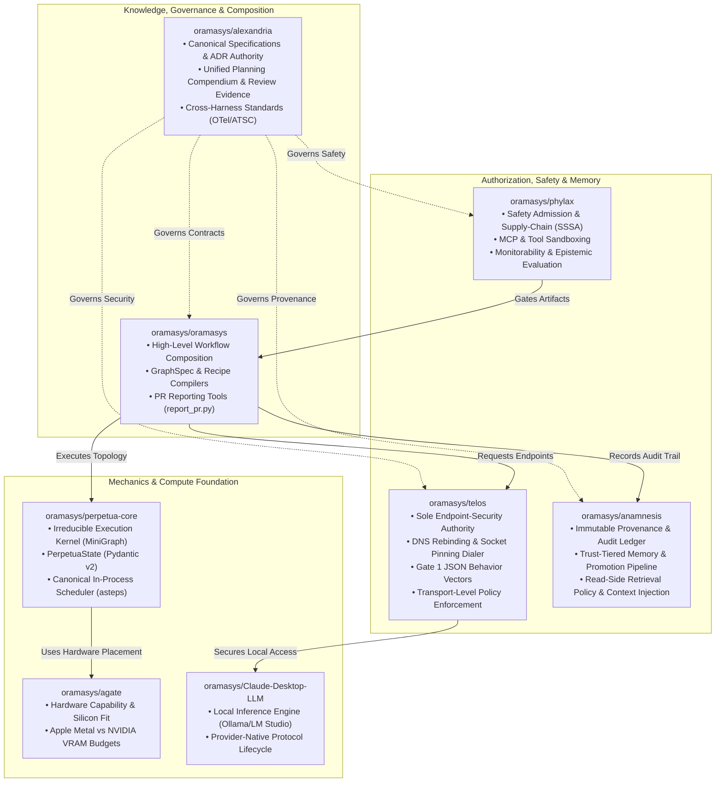
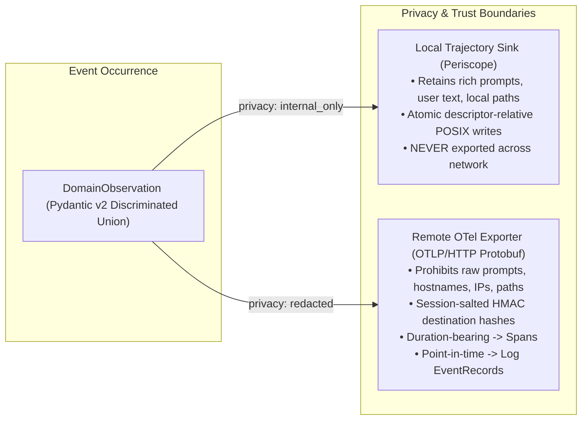
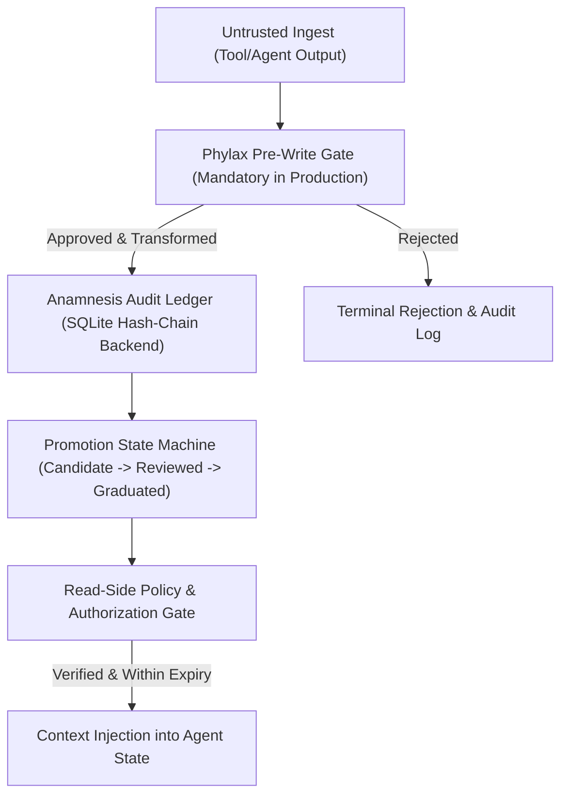

> **Alexandria ingest:** 2026-09-25 · docs-only synthesis copy · portable-memory scrubbed.

# oramasys/alexandria: Master Review, Dialectical Critique & Comprehensive Synthesis of All Plans

> **Document Type:** Canonical Architecture Review, Dialectical Critique & Unified Execution Synthesis  
> **Repository Authority:** `oramasys/alexandria` (v2 documentation authority)  
> **Source Baseline Repositories:** `diazMelgarejo/orama-system` (v1 methodology & ADR authority) · `diazMelgarejo/Perpetua-Tools` (v1 runtime engine) · `oramasys/*` (v2 unbundled ecosystem)  
> **Date:** September 2026  
> **Methodology:** `/oramasys-method` (AFRP Type C | Mode 4: Synthesize & Superset | Level: Expert Systems Architect)  
> **Governing Axiom:** *"Synthesize, never amputate. The library of Alexandria preserves every hard-won invariant, reconciles every dialectical critique, exposes every operational gap, and unifies the multi-agent trajectory toward an inevitable, human-amplifying synthetic consciousness."*

---

## Executive Summary: The State of the Architecture

Across 2026, the architecture underwent a profound transformation, moving through four major evolutionary epochs:
1. **Ad-Hoc Scripting & Local Hacks (v1):** Monolithic Python scripts in `Perpetua-Tools` and `orama-system` handling model discovery, routing, and prompt formatting.
2. **The Defense-in-Depth Crisis:** Confronting 2025–2026 SSRF CVEs (DNS rebinding, TOCTOU, redirect hijacking, AWS IMDS `169.254.169.254` credential exfiltration) which proved that pre-flight application string validation alone is fundamentally flawed.
3. **The Micro-Kernel & Observability Reconstruction:** Reconciling Kimi's 99-line state-machine engine with Claude's typed `PerpetuaState` runtime; establishing real OpenTelemetry W3C trace emission while isolating local rich Periscope trajectories.
4. **The Specialist v2 Ecosystem:** Unbundling the monolith into dedicated, fail-closed repositories under the `oramasys` organization (`alexandria`, `telos`, `phylax`, `anamnesis`, `agate`, `perpetua-core`, `Claude-Desktop-LLM`, and `oramasys`).

This compendium synthesizes every major planning document, review critique, and merge report in the project's lineage, providing a definitive audit of what was planned, what was built, what broke, and what must be executed next.

---

## 1. Multi-Repository Specialist Taxonomy & Invariants

To eliminate cross-repo contamination, cyclic dependencies, and premature coupling, the v2 ecosystem enforces a strict **separation of concerns**:



### The Specialist Division of Responsibility

| Repository | Canonical Domain | Hard Invariants & Exclusions |
| :--- | :--- | :--- |
| **`oramasys/alexandria`** | **Documentation, ADRs & Evidence Authority:** Houses all reconciled v2 specifications, architecture decision records, schema packages, and verification matrices. | Does **not** execute runtime logic or carry uncurated v1 archive dumps. |
| **`oramasys/telos`** | **Endpoint Security & Transport Dialer:** Owns destination reachability, DNS all-records validation, IP pinning, TLS SNI preservation, redirect isolation, and purpose-scoped endpoint authorization. | Does **not** own application workflow state or generic safety policies. |
| **`oramasys/phylax`** | **Safety Admission & Monitorability:** Inspects untrusted tools/MCPs, verifies supply-chain signatures (SSSA), and monitors multi-agent epistemic drift. | Does **not** handle network transport dialing or endpoint routing. |
| **`oramasys/anamnesis`** | **Epistemic Memory & Audit Ledger:** Structured semantic memory, lesson graduation, provenance hash-chains, and controlled retrieval authorization. | Does **not** mutate execution state directly. |
| **`oramasys/oramasys`** | **Application Composition & Orchestration:** High-level agent workflows, recipe/GraphSpec pipelines, and user-facing intents. | Does **not** create bespoke network dialers outside Telos. |
| **`oramasys/perpetua-core`** | **Micro-Kernel Engine:** Minimal state-machine execution (`MiniGraph`), state transitions, and step events (`asteps`). | **Strictly policy-free:** never imports providers, HTTP dialers, or hardware models. |
| **`oramasys/agate`** | **Hardware Affinity:** Profiles local silicon (Apple Metal, NVIDIA RTX), VRAM budgets, and compute placement. | Does **not** decide task routing or manage API credentials. |
| **`oramasys/Claude-Desktop-LLM`** | **Local Provider Adapter:** Protocol bridges for Ollama, LM Studio, and MLX. | Outsources all network reachability and endpoint safety to Telos. |

---

## 2. Foundational Governance & Ethical Doctrine

### 2.1 The Amplifier Principle (Non-Negotiable Core)
> *"AI amplifies human intent. It does not replace human judgment, absorb human accountability, or dissolve human moral agency."*

1. **Epistemic vs. Authorization Boundary:** Autonomous agents may explore, gather evidence, draft analyses, and run simulations. Agents **never self-authorize** destructive actions, external communications, git force operations, financial transactions, or persistent always-on swarms.
2. **Cryptographic Authorization:** Consequential decisions require real-world certified identity (GPG/PGP signatures or OIDC tokens) bound to an HMAC-validated `approval_token`.
3. **The 24-Hour Expiration Rule:** Always-on background agents accumulate context drift. Any agent operating autonomously expires after 24 hours unless an operator actively reviews and re-signs its lease.

### 2.2 MAESTRO Threat Modeling & The 4-Gate Framework
Modeled on OWASP GenAI Security Project standards:
- **Gate 0: Epistemic Qualification** — Workflow qualification filter requiring at least 4 of 5 green criteria before automation.
- **Gate 1: Pre-Flight Safety & Input Sanitization** — Telos and Phylax verification of endpoints, tools, and prompts.
- **Gate 2: Cryptographic Scope & Budget Reservation** — Atomic reservation of worst-case compute spend in durable SQLite ledgers before asynchronous provider I/O.
- **Gate 3: Execution & Merge Validation** — Deterministic verifiers, AST parsers, and regex checks ensuring factual consistency before assembly.
- **Gate 4: Emergency Stop / Human Review Barrier** — Non-bypassable human sign-off node required for client deliverables (EU AI Act Article 14) and unconditional kill-switch capability.

---

## 3. Execution Engine: MiniGraph Kernel Reconciliation

The execution engine in `perpetua-core` reconciles the dialectic between Kimi’s standalone 99-line micro-kernel and Claude’s typed runtime through an **integrative merge by invariant**:

```mermaid
graph TD
    MG["MiniGraph (Fluent Mutable Builder)"] -->|compile| CG["CompiledGraph (Detached Immutable Snapshot)"]
    CG --> ASTEPS["asteps() — Canonical In-Process Scheduler"]
    ASTEPS --> NODE_START["node.start event"]
    NODE_START --> EXEC["Inspect awaitability: inspect.isawaitable(delta)"]
    EXEC --> MERGE["Delta Verification: isinstance(delta, dict) -> PerpetuaState.merge()"]
    MERGE --> ROUTE["Conditional Edge Resolution: state -> str (sees merged state)"]
    ROUTE --> NODE_END["node.end event"]
    NODE_END -->|node != END & steps < max_steps| ASTEPS
    NODE_END -->|node == END| TERMINAL["state.merge(status='done')"]
    EXEC -->|type(exc).__name__ == 'Interrupt'| INTERRUPT["state.merge(status='interrupted')"]
```

### Reconciled Engine Invariants:
1. **Single Execution Scheduler (`asteps`):** `CompiledGraph` is the sole engine runtime. Streaming, tracing, checkpointing, and debugging plugins **must not** duplicate the traversal loop by inspecting private `_nodes` or `_edges`. They consume the public `asteps()` generator.
2. **Dynamic Awaitability:** The engine invokes the node first, then inspects the result using `inspect.isawaitable()`. This natively supports synchronous functions, `async def` functions, callable objects with `async __call__` (like `ToolNode`), and synchronous functions returning awaitables.
3. **Strict Dict-Delta Contract:** Nodes must return a dictionary delta. Returning `None` or a falsey non-dict is treated as an explicit contract failure (`TypeError`), preventing silent logic bugs.
4. **Explicit `END` Route:** `END` (`"__end__"`) is the only normal termination sentinel. Empty strings, `None`, or missing routes raise explicit routing errors.
5. **State Invariance:** `PerpetuaState` remains a Pydantic v2 `BaseModel` with explicit list provenance (`nodes_visited: list[str]`). Alternate dataclass states (`GraphState`) and loose `Callable[[Any], Any]` types are rejected.

---

## 4. Network Security & SSRF Defense-in-Depth

Security follows the **Three-Layer Floor** where each layer owns an independent physical boundary:

```text
┌────────────────────────────────────────────────────────────────────────┐
│ Layer 1: Application Pre-Flight (endpoint_policy_core.py)             │
│   • Scheme allowlist (https/http only), userinfo/CRLF rejection        │
│   • Enforces IP denylist: RFC1918, CGNAT, loopback, multicast, ULA     │
├────────────────────────────────────────────────────────────────────────┤
│ Layer 2: Socket-Pinning Transport (Telos & ssrf_pinned_adapter.py)     │
│   • Resolves DNS once; validates EVERY A/AAAA record                   │
│   • Splits Identity: Pinned IP literal is TCP target & PoolKey host    │
│   • Original Hostname preserved for TLS SNI & HTTP Host header         │
│   • Manual redirect loop: Every 30x Location re-evaluates L1 & L2      │
├────────────────────────────────────────────────────────────────────────┤
│ Layer 3: Operating System Network Floor (macOS pf & CNI)               │
│   • Universal Interface Filter: No hardcoded 'on en0'                   │
│   • Kernel drops: 169.254.0.0/16, fd00:ec2::254, fe80::/10             │
│   • Active ordering verification: Anchor must precede broad pass rules │
└────────────────────────────────────────────────────────────────────────┘
```

### The Split-Identity Rule
A common vulnerability in connection-pooling HTTP libraries is mutating shared `PoolManager` state (`self.poolmanager.connection_pool_kw.update()`). The architecture resolves this by setting the connection pool's destination host to the **pinned IP literal**, while routing the original domain name strictly through TLS SNI (`server_hostname`) and the HTTP `Host:` header via `build_connection_pool_key_attributes()`.

---

## 5. Tri-Stack Observability & Telemetry Governance

Observability decouples local interactive traces from remote enterprise metrics through the **Core + Planes + Adapters** model:



### Observability Invariants:
1. **Real OpenTelemetry SDK:** Eliminates custom pseudo-OTLP JSON forwarders. Remote telemetry uses official `opentelemetry-api` and `opentelemetry-exporter-otlp-proto-http` packages.
2. **Two-Tier Egress Cardinality:**
   - `egress.validation`: Emitted per DNS/socket validation attempt (measures `validation_ms`, logs `deny_reason`).
   - `egress.request.complete`: Emitted exactly once per logical HTTP transaction (measures total `duration_ms` and `status_code`).
3. **Multi-Agent Coordination Bias Sentinel:** The `CoordinationBiasDetector` requires at least **three distinct agent IDs** before evaluating groupthink/agreement collapse and is strictly prohibited from mutating task state or gating execution.

---

## 6. Frugality Engine & AI Model Routing

To guarantee cost-effective, high-reliability execution, models are routed through a 7-tier dispatch ladder, now updated to the canonical Anthropic Claude release structure:

| Tier | Engine / Model | Cost (In / Out per 1M) | Core Roles |
| :---: | :--- | :---: | :--- |
| **Tier 0–4** | Local Models (`glm-5.1:cloud`, `Qwen3.5-9B-MLX`, `Qwen3.5-27B-Opus-Distilled`) | **$0.00** | Local coding, syntax linting, unit testing, initial drafting, internal reasoning. |
| **Tier 5A** | `google/gemini-3.7-flash` (via Perplexity Agent API) | **$0.375 / $1.875** | Massive context ingestion (1M window), subagent parallel research, fast code transformation. |
| **Tier 5B** | `xai/grok-4.6` (via Perplexity Agent API) | **$2.00 / $6.00** | Real-time world knowledge, live market/financial pulse, contrarian critique, deep reasoning. |
| **Tier 5C** | `grok-4.6` (Direct xAI Fallback) | **$2.00 / $6.00** | Fallback if Perplexity Agent API is offline. Requires explicit `XAI_API_KEY`. |
| **Tier 6A (Default)** | **`Claude Sonnet 5 Medium`** (`claude-sonnet-5`, Effort: `Medium`) | **Standard Frontier Rate** | **Standard Claude Default:** Daily planning, everyday complex agentic tasks, primary architecture review, and synthesis. |
| **Tier 6B (Escalation)** | **`Claude Opus 5.5 High`** (`claude-opus-5-5`, Effort: `High`) | **Premium Frontier Rate ($4 / $20)** | **Gated Escalation:** Activated **ONLY** via explicit human-initiated request or human-gated / human-approved escalation for ambitious, complex challenges. |
| **Tier 6C (Special)** | **`Claude Fable 5.1`** (`claude-fable-5-1`) | **Usage Credits ($10 / $50)** | **Credit-Gated Escalation:** Long-horizon frontier challenges. Permitted **ONLY** under explicit human request/approval and when budget and usage credits are verified. |

### The 199k Token Cliff Guard
Both Perplexity and xAI double token pricing across the **entire request** ($4.00 / $12.00) if prompt input reaches 200,000 tokens. The `cost_guard.py` engine issues a hard warning at 180,000 tokens and automatically rejects, splits, or requires human authorization for requests exceeding 199,000 tokens.

---

## 7. Epistemic Memory: The Anamnesis Architecture

Based on the recursive gap review of `oramasys/anamnesis#1`, memory governance moves beyond in-memory lists into a tamper-evident audit ledger:



### Memory Governance Invariants:
1. **Mandatory Production Admission:** `Ledger.secure(gate=...)` is enforced in production; `gate=None` is restricted to isolated unit tests.
2. **Tamper-Evident Hash Chain:** Records include `record_hash` and `previous_record_hash` using $H_n = 	ext{SHA256}(	ext{canonical\_record}_n \parallel H_{n-1})$.
3. **Trust Tiers Distinct from Lifecycle States:** Lifecycle states (`candidate`, `reviewed`, `graduated`) are orthogonal to trust classifications (`untrusted`, `screened`, `trusted`, `restricted`, `expired`).
4. **Read-Side Policy Check:** Memory re-checks validity, repository scope, and expiration at retrieval time before context injection.

---

## 8. PR-Body Reporting & Metadata Integrity (v1 → v2)

Reconciling `scripts/cursor/append-pr-body.sh` into `oramasys/oramasys`:

1. **Comment-First Architecture (`report_pr.py`):** Reporting defaults to GitHub PR comments, completely bypassing the unclosable GitHub API lost-update race condition on PR body `PATCH` requests.
2. **Guarded Summary Path (`append_pr_summary.py`):** Retained exclusively for the repo-enforced `## Summary` header in PR descriptions. Maintains all three sequential integrity guards:
   - `PR_BODY_E_STALE_ON_REREAD`: Detects mid-flight human edits.
   - `PR_BODY_E_STALE_PREWRITE`: Detects concurrent writer collisions.
   - `PR_BODY_E_POSTWRITE_MISMATCH`: Verifies exact single-trailing-LF byte canonicalization post-write.
3. **Decoupled Tooling:** `gh` CLI invocations remain local trusted subprocesses; they are **not** routed through Telos HTTP dialers.

---

## 9. Comprehensive Implementation & Verification Matrix

The table below provides a unified ledger of what has been built versus what remains to be executed across the ecosystem:

| Milestone / Component | Canonical Location | Shipped / Verified State | Actionable Follow-Up |
| :--- | :--- | :---: | :--- |
| **Layer-3 macOS Firewall** | `Perpetua-Tools/scripts/security/` | 🟢 Universal rules without `on en0`; ECS metadata included; rule-ordering verified. | Run `verify-egress-pf-rules.sh --json` across all physical development Macs. |
| **Layer-2 Socket Pinning** | `PT/src/utils/ssrf_pinned_adapter.py` | 🟢 Split-identity DNS pinning; per-request pool kwargs; zero `PoolManager` mutation. | Maintain test suite coverage on all new HTTP client additions. |
| **Micro-Kernel Engine** | `perpetua-core/engine.py` | 🟢 Returned-value awaitability; `CompiledGraph` scheduler; Pydantic `PerpetuaState`. | Finalize `asteps()` scheduler seam to replace legacy plugin traversal loops. |
| **OTel Runtime Producer** | `PT/src/observability/runtime.py` | 🟢 Egress event bridge; OTLP HTTP/protobuf exporter; non-blocking delivery. | Deploy HTTPS collector and run `python -m src.observability.smoke`. |
| **Periscope Local Sink** | `PT/orchestrator/periscope_adapter.py` | 🟢 Atomic descriptor-relative writes; `internal_only` privacy boundary enforced. | Configure `openclaw_dirs` in desktop UI to point to local state root. |
| **Coordination Bias Sentinel** | `PT/orchestrator/coordination/` | 🟢 Bounded SQL; `pstdev` dispersion; requires $\ge 3$ distinct agent IDs; advisory-only. | None; operational in PR #369 / #372. |
| **Telos Authority** | `oramasys/telos` | 🟢 Standalone repo under Apache-2.0; Gate 1 behavior vectors; dedicated dialer. | Complete `perpetua-core` `health_probe()` migration to route through Telos. |
| **Anamnesis Memory** | `oramasys/anamnesis` | 🟡 Foundation PR #1 merged (in-memory ledger, gate protocol, promotion states). | Implement PR #2 (SQLite hash-chain backend) and PR #4 (read-side retrieval gate). |
| **PR Reporting Tooling** | `oramasys/oramasys` | 🟡 Plan completed (`v1-to-v2-pr-body-migration-plan.md`). | Implement `report_pr.py` (comment-first) and `append_pr_summary.py` in v2. |
| **Claude Model Governance** | `oramasys/alexandria` | 🟢 Canonical standard established (Sonnet 5 Medium default; Opus 5.5 High / Fable 5.1 escalation). | Enforce escalation decision template across all automated agent harnesses. |

---

## 10. Conclusion & Epistemic Trajectory

`oramasys/alexandria` fulfills its ancient namesake not by gathering uncurated scrolls, but by establishing a **harmonized, verifiable, and immutable system of truth**. By grounding synthetic agent coordination in:
- **Mathematical determinism** over probabilistic drift;
- **Strict regime boundaries** over tangled monolithic codebases;
- **Explicit model governance** (Sonnet 5 Medium baseline with human-gated Opus 5.5 High / Fable 5.1 escalation);
- **Zero-leak privacy** over naive exposure; and
- **The Amplifier Principle** as our permanent ethical North Star,

the architecture stands ready to scale from local multi-agent coding swarms into an enterprise-grade, multi-node computational infrastructure.
